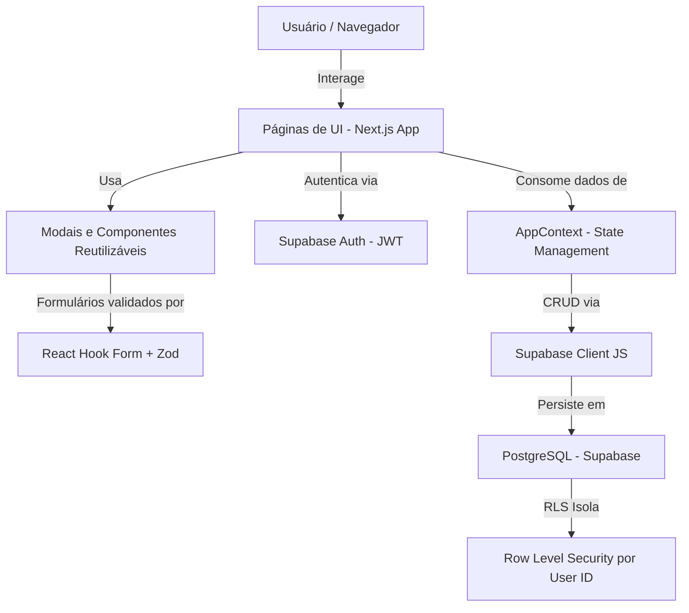

# 📊 Leal ERP - SaaS Business Management Suite

O **Leal ERP** é uma solução moderna e sofisticada de gerenciamento de recursos empresariais (ERP) no modelo SaaS, desenvolvido para pequenas e médias empresas que buscam alta performance, controle financeiro absoluto e facilidade no gerenciamento de inventário físico.

Este repositório foi construído seguindo os mais elevados padrões técnicos de arquitetura de software, design minimalista e boas práticas de engenharia de código, tornando-o ideal para **portfólios**, **avaliações de engenharia** e **demonstrações técnicas em entrevistas de contratação**.

---

## 🎨 Apresentação Visual & Design System
O projeto utiliza um design de alto padrão inspirado nas interfaces minimalistas da **Apple** e **Stripe**, com foco em:
- **Alta hierarquia tipográfica** (Inter Sans-Serif).
- **Consistência visual** e contraste otimizado para temas claros/escuros (Dark Mode integrado).
- **Microinterações e animações fluidas** usando Framer Motion para transições de estado sem quebras de layout.
- **Visualização analítica premium** com gráficos interativos e responsividade mobile-first completa.

---

## ⚡ Principais Funcionalidades
1. **Landing Page de Alta Conversão**: Página inicial institucional completa com seções de Hero, Prova Social, Etapas de Funcionamento, Grade de Planos de Assinatura, Diferenciais Técnicos e FAQs interativos animados.
2. **Dashboard de Performance**: Painel analítico exibindo receitas acumuladas, lucros líquidos projetados, contagem de clientes ativos, gráficos de Receitas vs Despesas agrupados por período e alertas reativos de estoque crítico.
3. **Módulo de Vendas (PDV Digital)**: Fluxo rápido de registro de pedidos com seleção dinâmica de múltiplos produtos, validação imediata de estoque mínimo, cálculo de totais em tempo real e baixa automática do produto e lançamento de receita.
4. **Módulo de Estoque e Inventário**: Controle em tempo real das unidades por SKU. Permite registrar entradas (com lançamento de despesa de custo correspondente no caixa) e saídas manuais para controle de perdas ou auditorias.
5. **Gestão de Clientes**: Cadastro completo e estruturado de clientes corporativos e individuais (CPF/CNPJ, endereços e contatos unificados).
6. **Módulo Financeiro**: Registro consolidado de transações de entrada e saída. Controle de saldo atualizado de caixa com fluxo completo de categorias financeiras.
7. **Relatórios Gerenciais**: Tela com geradores de relatórios consolidados em múltiplos formatos como PDF e planilhas estruturadas.

---

## 🏗️ Arquitetura de Software
A aplicação foi projetada no Next.js 15 (App Router) com Supabase como backend, separando a camada de visualização dos serviços de negócios. A arquitetura de dados segue o seguinte fluxo de responsabilidades:



### Stack Tecnológica:
- **Core**: Next.js 15 (App Router) & React 19
- **Backend**: Supabase (PostgreSQL, Auth, RLS, RPC)
- **Estilo**: Tailwind CSS (v4) & Shadcn UI
- **Animações**: Motion (Framer Motion)
- **Validação de Contratos**: Zod + React Hook Form
- **Suíte de Testes**: Vitest & React Testing Library (JSDOM)
- **Containerização**: Docker & Docker Compose

---

## 🚀 Como Executar o Projeto Localmente

### Pré-requisitos
- Node.js (versão 20 ou superior)
- npm ou yarn

### Passo a Passo

1. **Clonar o repositório**:
   ```bash
   git clone https://github.com/yuriOleal/leal-erp.git
   cd leal-erp
   ```

2. **Instalar dependências**:
   ```bash
   npm install
   ```

3. **Configurar variáveis de ambiente**:
   Crie um arquivo `.env.local` na raiz baseado no `.env.example`:
   ```bash
   cp .env.example .env.local
   ```
   Preencha com as credenciais do seu projeto Supabase:
   - `NEXT_PUBLIC_SUPABASE_URL`: URL do projeto (ex: `https://xxxxx.supabase.co`)
   - `NEXT_PUBLIC_SUPABASE_ANON_KEY`: Chave anônima pública
   
   > ⚠️ **Importante**: Execute `supabase/migration.sql` e, em seguida, `supabase/migration-v1.0.4.sql` no SQL Editor do Supabase. O segundo arquivo reforça as regras de venda, adiciona histórico de estoque e garante que pedidos pendentes não movimentem caixa ou saldo.

4. **Rodar em desenvolvimento**:
   ```bash
   npm run dev
   ```
   Acesse a aplicação em [http://localhost:3000](http://localhost:3000).

5. **Compilar build de produção**:
   ```bash
   npm run build
   npm run start
   ```

---

## 🧪 Suíte de Testes
Os testes do projeto focam em regras críticas de negócios, como validações de CPF/CNPJ de clientes e regras de precificação.

- Para rodar todos os testes em modo único (CI):
  ```bash
  npm run test
  ```

---

## 🐳 Docker (DevOps)
O projeto está preparado para rodar em containers, simulando ambientes de staging e produção.

- **Subir aplicação via Docker Compose**:
  ```bash
  docker-compose up --build
  ```
  A aplicação estará disponível em [http://localhost:3000](http://localhost:3000).

---

## 🛣️ Roadmap: Evolução Full Stack

1. ✅ **Banco de Dados Relacional**: Persistência no **PostgreSQL** via **Supabase** com RLS.
2. ✅ **Autenticação Segura**: Login, registro e recuperação de senha via **Supabase Auth** com **JWT**.
3. 🔜 **Consumo de API Reativo**: Migrar de Context API para **TanStack Query** (React Query) para cache e invalidação inteligente.
4. 🔜 **Controle de Acesso RBAC**: Middleware de autorização por perfil (admin, vendedor, financeiro).
5. 🔜 **Testes de Integração**: Testes end-to-end com Playwright cobrindo fluxos críticos.
6. 🔜 **CI/CD**: GitHub Actions para build, teste e deploy automático na Vercel.

---

## 📄 Licença
Este projeto está licenciado sob a Licença MIT - consulte o arquivo [LICENSE](LICENSE) para obter detalhes.
